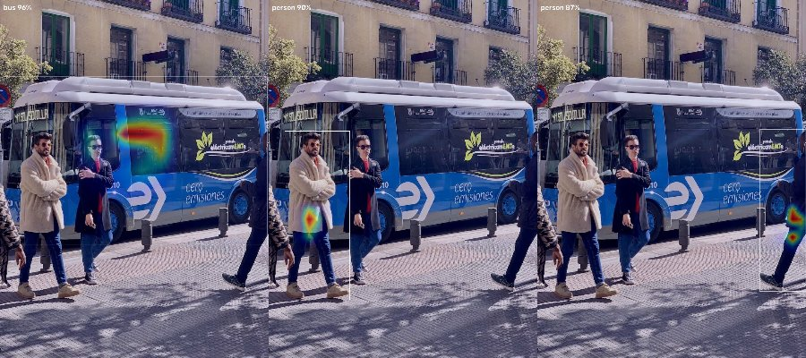
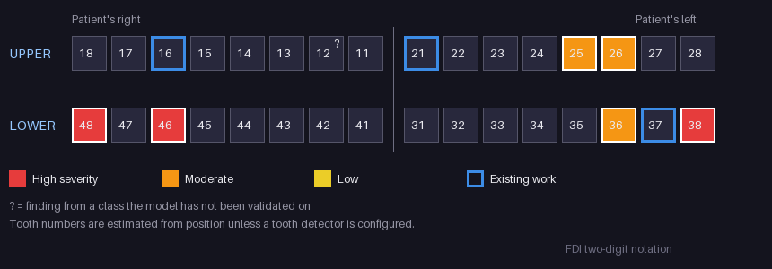
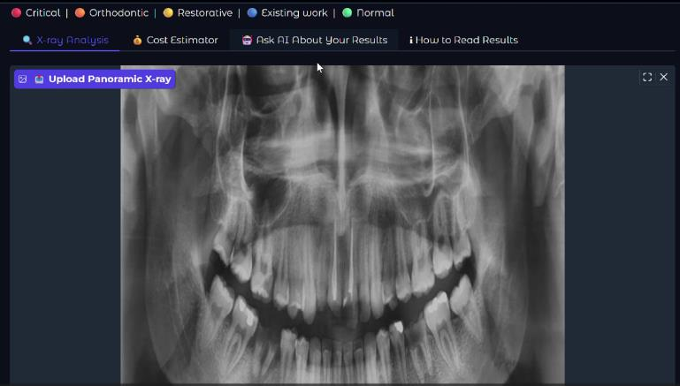
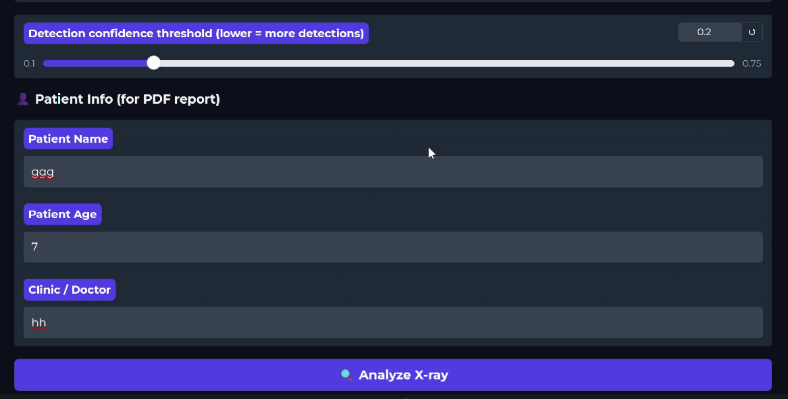
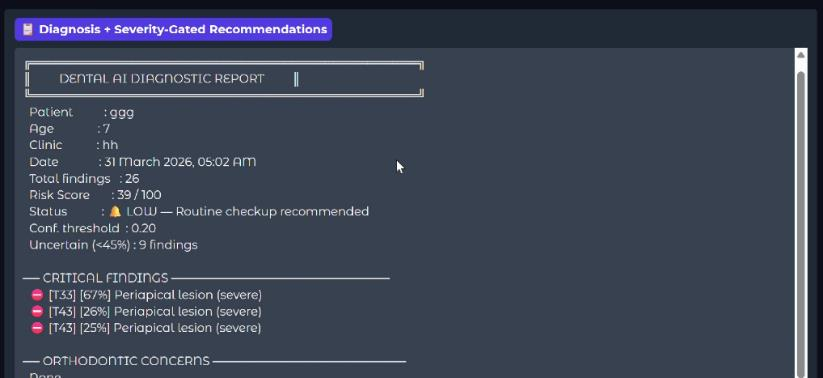
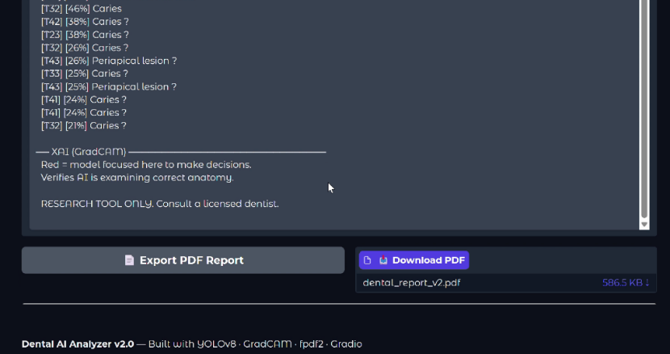

<div align="center">

# 🦷 AI Dental X-Ray Analyzer

### Explainable detection of findings in panoramic dental radiographs

*YOLOv9 detection · per-finding HiResCAM explanations · FDI tooth chart · PDF report · indicative costs*

[](https://www.python.org/)
[](https://pytorch.org/)
[](https://github.com/ultralytics/ultralytics)
[](https://gradio.app/)
[](LICENSE)

[](#-results)
[](#%EF%B8%8F-limitations)

<!-- Animated banners; generated by scripts/build_robots.py and scripts/build_pixel_cats.py in github.com/HemashreeVI/HemashreeVI (--theme light-dark) -->



<a href="https://youtu.be/QV3yqZAQpqA">🎥 Demo</a> •
<a href="#-features">✨ Features</a> •
<a href="#-results">📊 Results</a> •
<a href="#%EF%B8%8F-installation">⚙️ Installation</a> •
<a href="#-training--evaluation">🧪 Training & evaluation</a> •
<a href="#%EF%B8%8F-limitations">⚠️ Limitations</a>

</div>

---

## 📖 Overview

**AI Dental X-Ray Analyzer** detects findings in **panoramic radiographs (OPGs)**: caries, periapical lesions,
bone loss, impacted and missing teeth, existing restorations and anatomy. It then turns them into an
FDI tooth chart, a structured PDF report and an indicative treatment-cost estimate, in a Gradio app.

Every detection can be explained with a **HiResCAM** heatmap computed from that detection's own class score,
so a clinician can check *what the model looked at* for each finding.

> ⚠️ **Research prototype, not a medical device.** Test-set mAP@50 is 38.7%. Findings, tooth numbers and costs
> must be confirmed by a licensed dentist.

---

## ✨ Features

| | |
|---|---|
| 🎯 **Detection** | YOLOv9c trained on 31 classes. Each finding has a *severity* (clinical) and a *confidence* (model), reported separately |
| ✅ **Reliability gating** | Classes the model can't detect reliably are marked *unvalidated*, drawn greyed out, and kept out of the risk score, costs and recommendations |
| 🔍 **Per-finding explanations** | HiResCAM (a Grad-CAM variant) for any single detection or the top 8, with a class-agnostic EigenCAM fallback |
| 🦷 **FDI tooth chart** | Panoramic orientation (patient's right on the viewer's left) with the worst finding per tooth. Optionally uses a tooth-numbering detector |
| 📄 **PDF report** | Unicode text (₹, names with accents), page numbers on every page, tables, chart and heatmap |
| 💰 **Indicative costs** | Per affected tooth, validated findings only (India, 2024 ranges) |
| 🤖 **Ask about the results** | Optional plain-language Q&A via Claude. Only de-identified findings are sent |

---

## 📊 Results

Held-out **test split: 1,380 images**. Training set: 9,674 images. Model: YOLOv9c (25.3 M parameters).

| Metric | Value |
|---|---|
| mAP@50 | **38.7%** |
| mAP@50-95 | 25.1% |
| Mean precision | 40.3% |
| Mean recall | 37.5% |

These come from `notebooks/colab_v2_app_and_evaluation.ipynb` (`model.val(split='test', conf=0.25)`).
Two caveats about that run:

- **`conf=0.25` under-reports mAP.** ultralytics uses `conf=0.001` for mAP. Re-run `scripts/evaluate.py` for
  the definitive number.
- **The per-class chart from that notebook has the wrong labels** (see [notebooks/README.md](notebooks/README.md)),
  so no per-class table is published here yet. `scripts/evaluate.py` produces a correct one.

> Earlier versions of this README reported "97.3% accuracy". That number came from the confusion matrix with
> the background row and column removed, which ignores every missed and every false detection. It is not a
> detection metric and has been withdrawn, along with a baseline-comparison table that had no supporting code.

### Class balance (training set)

The data is extremely imbalanced. Several classes, including **Malaligned (7 boxes)**, are too rare to learn.

| Boxes | Classes |
|---|---|
| > 10,000 | Filling (34,053), impacted tooth (19,573), Root Canal Treatment (13,100) |
| 1,000 – 10,000 | Crown (7,649), Caries (7,357), Periapical lesion (3,633), Missing teeth (2,363), Bone Loss (2,151), Root Piece (1,700), Implant (1,175) |
| 100 – 1,000 | Mandibular Canal (420), maxillary sinus (318), post - core (231), wire (162), Primary teeth (154), Retained root (120) |
| < 100 | orthodontic brackets (94), metal band (49), Supra Eruption (39), abutment (23), attrition (21), gingival former (14), Fracture teeth (10), Permanent Teeth (10), permanent retainer (8), plating (8), **Malaligned (7)**, Cyst (3), Root resorption (3), TAD (1), bone defect (0) |

Until a per-class evaluation exists, the app treats classes with fewer than 100 training boxes as *unvalidated*.
After `scripts/evaluate.py --update-gating`, it uses per-class AP@50 instead (≥ 30% on ≥ 10 test boxes).

---

## 🏗️ Architecture

```
Panoramic X-ray ──▶ YOLOv9c ──▶ findings ──┬──▶ reliability gating ──▶ risk score · costs · ortho notes
                       │                    ├──▶ FDI numbering (tooth detector, or position estimate) ──▶ chart
                       │                    └──▶ annotated image
                       └── P3/P4/P5 features + ∂score/∂features ──▶ HiResCAM per detection
                                                            all of the above ──▶ text report · PDF
```

| Module | Responsibility |
|---|---|
| `dental_ai/config.py` | Class categories, severities, risk weights, costs, reliability gating |
| `dental_ai/inference.py` | Model loading (local / Hugging Face Hub / Google Drive), detection, annotation |
| `dental_ai/findings.py` | Severity, confidence bands, risk score, per-tooth costs, orthodontic discussion points |
| `dental_ai/fdi.py` | FDI numbering (tooth detector or anatomical estimate) and the chart |
| `dental_ai/cam.py` | Letterboxing, per-detection HiResCAM, EigenCAM fallback, overlays |
| `dental_ai/report.py` | Analysis summary, text report, PDF |
| `dental_ai/chatbot.py` | Optional Q&A with Claude on de-identified findings |
| `app.py` | Gradio UI |
| `scripts/` | Dataset statistics, leakage check, class merging, training, evaluation |

### Explanations

For each detection, `DetectionCAM` letterboxes the image like ultralytics does and runs the network with hooks
on the three feature maps that feed the Detect head. It then finds the anchor that produced the detection
(best IoU × class score) and back-propagates **that anchor's class score**. The map is
`ReLU(Σ ∂score/∂A ⊙ A)` on the anchor's feature level, mapped back to the original image.

HiResCAM was chosen over plain Grad-CAM after measuring both on 8 detections from a COCO-pretrained YOLOv9t:

| Method | Peak inside the detected box | Heat in box vs. its area share |
|---|---|---|
| Grad-CAM | 3 / 8 | 2.5× |
| **HiResCAM** | **8 / 8** | **14.0×** |


*Each panel explains one detection (bus, then two different people). The heat lands on the object being
explained. This check runs in the test suite (`tests/test_cam.py::test_localises_pretrained`).*

### FDI tooth numbering



With a tooth-numbering detector (`TOOTH_MODEL_PATH`, a YOLO model whose class names are FDI numbers), each
finding gets the tooth it overlaps most. Without one, the number is **estimated** from position and marked
with `~`. The estimate accounts for unequal tooth widths and the curved occlusal plane, but it is still
approximate.

---

## ⚙️ Installation

```bash
git clone https://github.com/HemashreeVI/AI_Malocclusion_Detection.git
cd AI_Malocclusion_Detection
python -m venv .venv && source .venv/bin/activate     # Windows: .venv\Scripts\activate
pip install -r requirements.txt
```

## 🚀 Usage

```bash
python app.py              # http://localhost:7860
SHARE=1 python app.py      # public gradio.live link — see the privacy note below
```

The weights are found in this order:
1. `MODEL_PATH` (default `weights/best.pt`)
2. Hugging Face Hub: `HF_MODEL_REPO` (+ `HF_MODEL_FILE`)
3. The published Google Drive checkpoint (`MODEL_GDRIVE_ID`)

| Variable | Purpose |
|---|---|
| `TOOTH_MODEL_PATH` | Optional tooth-numbering YOLO model, for real FDI numbers |
| `MIN_RELIABLE_AP50`, `MIN_TEST_INSTANCES`, `MIN_TRAIN_INSTANCES` | Gating thresholds (defaults 0.30 / 10 / 100) |
| `ANTHROPIC_API_KEY` | Enables the *Ask about the results* tab |

**Colab:** open [`notebooks/colab_quickstart.ipynb`](notebooks/colab_quickstart.ipynb).
**Permanent hosting:** see [docs/DEPLOY.md](docs/DEPLOY.md) (Hugging Face Spaces).

> 🔒 **Privacy.** Patient details are only used in the PDF and are never sent to the chatbot. Don't upload
> identifiable radiographs to a public share link or Space without consent.

---

## 🧪 Training & evaluation

```bash
# 1. Inspect the data
python scripts/class_stats.py   --data dental.yaml
python scripts/check_leakage.py --data dental.yaml --resplit splits/      # same radiograph in two splits?

# 2. Merge/drop rare classes and oversample the rest (plan in configs/class_merge.yaml)
python scripts/prepare_dataset.py --data dental.yaml --splits splits/ --out data/merged

# 3. Train (imgsz 1024, grayscale-appropriate augmentation), then evaluate on test
python scripts/train.py --data data/merged/data.yaml

# Or evaluate an existing model; --update-gating makes the app use the per-class results
python scripts/evaluate.py --data dental.yaml --split test --update-gating
```

`evaluate.py` writes `results/metrics.json`, `results/per_class.md` and `results/ap50_per_class.png`. It uses
`conf=0.001` and maps per-class results through `ap_class_index`, and it never reports confusion-matrix
"accuracy".

`check_leakage.py` groups Roboflow-style augmented copies (`name_jpg.rf.<hash>.jpg`) and near-duplicate images
(perceptual hash), then re-splits so each source radiograph is in exactly one split.

### Tests

```bash
pip install -r requirements-dev.txt
pytest
```

---

## ⚠️ Limitations

- **Overall accuracy is modest** (mAP@50 38.7%), and many classes have too little data to be usable.
- **This is not a malocclusion classifier.** A panoramic X-ray alone cannot establish malocclusion type or
  severity; that needs a clinical exam, cephalometrics or study models. The app lists *discussion points* for
  a clinician, never a treatment choice. With 7 training examples, *Malaligned* is currently unvalidated.
- **Tooth numbers are estimates** unless a tooth-numbering model is configured.
- **Costs are indicative** ranges for India (2024).
- **No patient-level split is guaranteed.** The leakage check finds duplicate images, not different
  radiographs of the same patient.

## 🗺️ Roadmap

- [ ] Re-run `scripts/evaluate.py` on the test split and publish the per-class table
- [ ] Re-split without leakage, merge rare classes and retrain at 1024 px
- [ ] Add a tooth-numbering model (e.g. trained on a public FDI-annotated OPG dataset)
- [ ] Malocclusion-specific data (cephalograms / intraoral photos) for actual malocclusion classification
- [ ] Reader study: model + dentist vs dentist alone

---

## 🖼️ Screenshots (v2 UI)

| Upload panel | Analysis controls |
|---|---|
|  |  |

| Diagnostic report | PDF export |
|---|---|
|  |  |

---

## 👥 Author

| Name | Role |
|---|---|
| **V I Hemashree** | AI/ML development, system architecture, explainable-AI integration |

*School of Computer Science and Engineering, Vellore Institute of Technology, Chennai*

## 📄 License

MIT. See [LICENSE](LICENSE).
